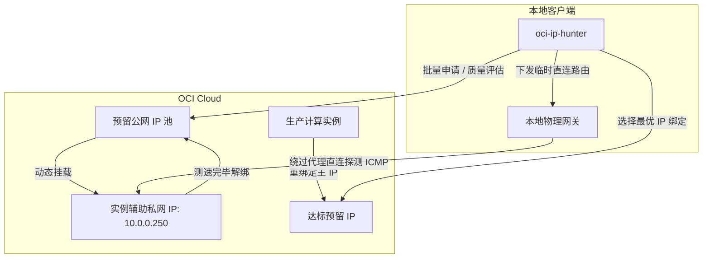

# oci-ip-hunter

[](https://www.python.org/downloads/)
[](https://github.com/oracle/oci-python-sdk)
[](LICENSE)
[](https://github.com/astral-sh/ruff)

Oracle Cloud Infrastructure (OCI) 预留公网 IPv4 自动化优选工具。提供批量申请与风险筛选、物理网卡直连延迟评测（绕过本地 TUN/VPN 代理）以及云主机主公网 IP 一键重绑定功能。

---

## 🌟 功能特性

- **批量申请与质量快筛 (`Hunt`)**: 自动化批量申请预留公网 IP，结合欺诈分（Scamalytics）、IP 纯净度（IPPure）及流媒体/AI 连通性进行多维度评估；达标 IP 自动保留并重命名，未达标立即释放。
- **真实链路直连测速 (`Latency`)**: 在 Windows 环境下通过注入物理网卡临时主机路由，彻底绕过本地 TUN 虚拟网卡（如代理客户端），测量真实公网往返时延（RTT）、网络抖动（Jitter）及丢包率。
- **无损辅助私网 IP 测试桩**: 测速过程挂载于实例辅助私网 IP（Secondary Private IP），通过 1:1 NAT 映射探测，不影响生产实例原有的主公网 IP 及业务连接。
- **实例主公网 IP 重绑定 (`Bind`)**: 将筛选出的预留 IP 一键关联至生产计算实例的主私网 IP，自动清理原有临时公网 IP 或解绑旧预留 IP。
- **多维度风险与解锁检测 (`ip_quality.py`)**: 静态检测任意公网 IP 的风险画像，包括欺诈分、纯净度、机房/原生广播属性、25 端口出站状态及流媒体/AI 服务可用性。
- **纯 Python SDK 实现**: 采用 OCI 官方 Python SDK 与 REST API，无需安装外部 OCI CLI 工具。

---

## 🏗️ 架构与模式总览



### 核心工作模式对比

| 模式 (`--mode`) | 核心测试内容 | 是否需要云主机 | 测速/体检耗时 | 适用场景 |
| :--- | :--- | :---: | :---: | :--- |
| **`quality` 深度全景模式**<br>(默认，不加 `--fast`) | • 欺诈分 (Scamalytics)<br>• **IPPure 纯净度与人机流量比**（调用 Playwright 浏览器）<br>• 7 大流媒体与 AI 解锁<br>• 25 端口 / 原生机房 / 黑名单 | ❌ 否 | 约 12~18s / IP | 需要获取最完整、最精确的全维度风控报告。 |
| **`quality` 快速快筛模式**<br>(加 `--fast`) | • 欺诈分 (Scamalytics)<br>• 7 大流媒体与 AI 解锁<br>• 25 端口 / 原生机房 / 黑名单<br>• **跳过 IPPure 浏览器渲染（免检）** | ❌ 否 | 约 2~4s / IP | **批量申请筛选 (`--hunt`) 的推荐首选**。快速剔除劣质 IP。 |
| **`latency` 挂桩测速模式** | • 真实物理往返时延 (RTT)<br>• 网络抖动 (Jitter)<br>• 实际丢包率 (Packet Loss)<br>• *（不测流媒体和欺诈分）* | ✅ 是<br>(挂载至 `10.0.0.250`) | 约 10~30s / IP<br>(取决于设定的测速轮数) | 评估本地网络直连这批 IP 的网络延迟与晚高峰稳定性，输出排行榜。 |
| **`pipeline` 双检流水线模式** | **先质量快筛，再测物理延迟**：<br>1. 门禁一：质量达标（欺诈低、解锁多）<br>2. 门禁二：自动挂桩测物理延迟与丢包<br>（两道门禁全部达标才最终保留） | ✅ 是 | 动态耗时<br>(劣质 IP 秒删，达标 IP 才测速) | 一步到位：既要 IP 干净、解锁好，又要直连延迟低。 |
| **`bind` 生产换绑模式** | • *（不执行测试）*<br>• 纯运维操作：将指定的预留 IP 绑定到生产实例主网卡 | ✅ 是 | 约 2~3s | 挑出满意的 IP 后，一键上线替换生产主机的公网 IP。 |

---

## 📦 运行环境与安装

### 前提条件
- Python 3.10 或更高版本
- 已配置 OCI API 凭据（见下文）
- Windows 环境下执行直连测速需**管理员权限**（用于临时在物理网卡注入直连主机路由）

### 安装依赖

推荐使用 [`uv`](https://github.com/astral-sh/uv)：

```bash
git clone https://github.com/WMGray/oci-ip-hunter.git
cd oci-ip-hunter

# 使用 uv 同步虚拟环境（推荐）
uv sync

# 或使用 pip 安装
pip install -r requirements.txt
```

---

## ⚙️ 配置说明

在本地 `~/.oci/config`（Windows 为 `C:\Users\<USER>\.oci\config`）中配置 OCI 凭据：

```ini
[DEFAULT]
user=ocid1.user.oc1..aaaaaaaaxxxxxxxxxxxxxxxxxxxxxxxxxxxx
fingerprint=20:3b:97:13:55:1c:xx:xx:xx:xx:xx:xx:xx:xx:xx:xx
key_file=~/.oci/oci_api_key.pem
tenancy=ocid1.tenancy.oc1..aaaaaaaaxxxxxxxxxxxxxxxxxxxxxxxxxxxx
region=<YOUR_REGION>
```

> 说明：`<YOUR_REGION>` 为您的 OCI 区域标识代码（如 `us-ashburn-1`、`ap-tokyo-1` 等）。

---

## 📖 CLI 命令行参数参考 (`-h`)

### 1. 全局与通用参数

| 参数 | 默认值 | 作用说明 |
| :--- | :--- | :--- |
| **`--mode`** | `quality` | **运行主模式**：`quality` (质量筛选), `latency` (测试桩测速), `pipeline` (双检流水线), `bind` (生产换绑) |
| **`--profile`** | `DEFAULT` | 指定读取 `~/.oci/config` 中的 Profile 节点名称（适用于多账号切换） |
| **`--region`** | 自动读取 | 手动覆盖配置中的区域标识（默认自动从 config 中读取） |

### 2. 批量申请与质量筛选参数 (`--mode quality`)

| 参数 | 默认值 | 作用说明 |
| :--- | :--- | :--- |
| **`--hunt`** | `False` | **开启自动化批量循环申请**。按批次申请预留 IP 并体检，达标保留、劣质释放，直到凑齐目标数量 |
| **`--fast`** | `False` | **快速快筛模式**。跳过较耗时的 Playwright 浏览器 IPPure 渲染（2~4 秒/IP），IPPure 免检通过 |
| **`--batch-size`** | `5` | 批量模式下每批次向 OCI 一次性申请的 IP 数量（建议 3~5 个） |
| **`--target-count`**| `5` | 目标保留的达标 IP 数量，达成后自动停止运行 |
| **`--max-batches`** | `10` | 批量循环的最大轮次数，防止无限循环 |
| **`--max-scam`** | `5` | 欺诈分准入门槛（Scamalytics，必须严格小于此值，分数越小越干净） |
| **`--max-ippure`** | `35.0` | IPPure 纯净度系数门槛（百分比，必须 $\le$ 此值，fast 模式下免检） |
| **`--min-streaming`**| `4` | 最低流媒体与 AI 解锁数量门槛（YouTube、Netflix、Disney+、ChatGPT、Claude 等共 7 项） |
| **`--naming-prefix`**| `vip-pure` | 达标保留 IP 在 OCI 中的命名规则（如自动命名为 `vip-pure-01`、`vip-pure-02`） |
| **`--cooldown`** | `4.0` | 批次之间的休眠冷却时间（秒，内置动态随机抖动，防止高频调用触发 OCI API 风控） |
| **`--allocate`** | `False` | 单 IP 模式下申请一个全新的预留 IP 进行体检（默认测试租户中现有的预留 IP） |
| **`--auto`** | `False` | 单 IP 模式下全自动裁决：达标自动保留并重命名，未达标立即释放（无需人工确认） |
| **`--release`** | `False` | 纯测试参数：体检完成后强制释放该 IP（不占配额，仅看体检数据） |
| **`--timeout`** | `15.0` | 各风控检测 API 的超时时长（秒） |

### 3. 测试桩物理直连测速参数 (`--mode latency`)

| 参数 | 默认值 | 作用说明 |
| :--- | :--- | :--- |
| **`--all`** | `False` | **对租户内所有已保留的公网 IP 逐个挂桩测速**，并输出综合排行榜 |
| **`--ip`** | 空 | 指定测试某一个具体的预留公网 IP（若不指定则弹出交互菜单供选择） |
| **`--rounds`** | `5` | 测速重复轮数。每轮测完后安全解绑，最后统计平均 RTT、抖动与丢包率（高精度稳定性压测推荐设为 `20`） |
| **`--ping-count`** | `4` | 每一轮探测中发送的 ICMP 数据包个数 |
| **`--gateway`** | 自动探测 | 本地物理网关 IP。默认自动获取物理网卡网关，用于下发临时直连主机路由以穿透 TUN 代理 |
| **`--instance`** | `oci-main-arm` | 测试桩所依托的计算实例名称（如实例名不同，需通过此参数指定） |

### 4. 双检流水线与生产换绑参数 (`--mode pipeline / bind`)

| 参数 | 默认值 | 作用说明 |
| :--- | :--- | :--- |
| **`--max-rtt`** | `220.0` | 仅在 `--mode pipeline` 生效。质量筛选合格且**平均延迟 $\le$ 此阈值（毫秒）**的 IP 才最终保留 |

---

## 💡 常用实战命令配方 (Cookbook)

### 场景 1：极速批量申请与筛选优质 IP (推荐首选)
```bash
# 每次申请 5 个，秒级快筛，凑齐 5 个达标 IP 后自动停止
uv run python tools/oracle_ip_loop.py --hunt --fast
```

### 场景 2：自定义严格门槛批量优选
```bash
# 门槛要求：欺诈分 < 3，流媒体解锁 >= 5 项
uv run python tools/oracle_ip_loop.py --hunt --fast --max-scam 3 --min-streaming 5
```

### 场景 3：租户现有预留 IP 高精度 20 轮稳定性测速与排行
```bash
# 连续 20 轮采样，精准统计平均 RTT、Jitter 与丢包率并生成排行榜
uv run python tools/oracle_ip_loop.py --mode latency --all --rounds 20 --instance <YOUR_INSTANCE_NAME>
```

### 场景 4：质量 + 延迟双达标流水线 (一步到位)
```bash
# 质量达标且物理直连平均延迟 <= 220ms 才保留，否则自动释放
uv run python tools/oracle_ip_loop.py --mode pipeline --fast --max-rtt 220.0 --instance <YOUR_INSTANCE_NAME>
```

### 场景 5：将选优的预留 IP 一键换绑至生产主机
```bash
# 将指定的预留 IP 绑定为云主机的主公网 IP（自动清理旧公网 IP）
uv run python tools/oracle_ip_loop.py --mode bind --ip <SELECTED_PUBLIC_IP> --instance <YOUR_INSTANCE_NAME>
```

### 场景 6：离线检测任意单个 IP 或 IP 列表 (`ip_quality.py`)
```bash
# 检测单个公网 IP 并展示完整仪表盘
uv run python tools/ip_quality.py 1.1.1.1

# 批量体检文件中的 IP 列表
uv run python tools/ip_quality.py --file tools/ips.example.txt
```

---

## 🔧 测试桩说明

为确保测速过程不中断生产实例现有连接，测速功能依托实例上的**辅助私网 IP**（默认 `10.0.0.250`）。测速时工具将待测预留公网 IP 临时绑定至该私网 IP，测完立即解绑。

首次使用时，需在目标 Linux 实例内部为网卡添加该辅助私网 IP：

```bash
# 确认网卡接口名（如 enp0s6 或 ens3）
ip addr

# 为网卡添加辅助私网 IP（单次执行即可）
sudo ip addr add 10.0.0.250/24 dev enp0s6
```

---

## 📄 许可证

本项目基于 [MIT License](LICENSE) 许可发布。
