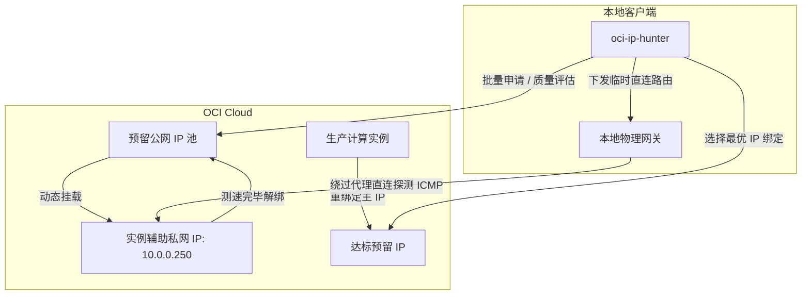

# oci-ip-hunter

[](https://www.python.org/downloads/)
[](https://github.com/oracle/oci-python-sdk)
[](LICENSE)
[](https://github.com/astral-sh/ruff)

Oracle Cloud Infrastructure (OCI) 预留公网 IPv4 自动化优选工具。提供批量申请与风险筛选、物理网卡直连延迟评测（绕过本地 TUN/VPN 代理）以及云主机主公网 IP 一键重绑定功能。

---

## 功能特性

- **批量申请与质量快筛 (`Hunt`)**: 自动化批量申请预留公网 IP，结合欺诈分（Scamalytics）、IP 纯净度（IPPure）及流媒体/AI 连通性进行多维度评估；达标 IP 自动保留并重命名，未达标立即释放。
- **真实链路直连测速 (`Latency`)**: 在 Windows 环境下通过注入物理网卡临时主机路由，彻底绕过本地 TUN 虚拟网卡（如代理客户端），测量真实公网往返时延（RTT）、网络抖动（Jitter）及丢包率。
- **无损辅助私网 IP 测试桩**: 测速过程挂载于实例辅助私网 IP（Secondary Private IP），通过 1:1 NAT 映射探测，不影响生产实例原有的主公网 IP 及业务连接。
- **实例主公网 IP 重绑定 (`Bind`)**: 将筛选出的预留 IP 一键关联至生产计算实例的主私网 IP，自动清理原有临时公网 IP 或解绑旧预留 IP。
- **多维度风险与解锁检测 (`ip_quality.py`)**: 静态检测任意公网 IP 的风险画像，包括欺诈分、纯净度、机房/原生广播属性、25 端口出站状态及流媒体/AI 服务可用性。
- **纯 Python SDK 实现**: 采用 OCI 官方 Python SDK 与 REST API，无需安装外部 OCI CLI 工具。

---

## 架构示意



---

## 运行环境与安装

### 前提条件
- Python 3.10 或更高版本
- 已配置 OCI API 凭据（见下文）
- Windows 环境下执行直连测速需**管理员权限**（用于临时操作本地路由表）

### 安装依赖

推荐使用 [`uv`](https://github.com/astral-sh/uv)：

```bash
git clone https://github.com/WMGray/oci-ip-hunter.git
cd oci-ip-hunter

# 使用 uv 同步虚拟环境
uv sync

# 或使用 pip 安装
pip install -r requirements.txt
```

---

## 配置说明

在本地 `~/.oci/config`（Windows 为 `C:\Users\<USER>\.oci\config`）中配置 OCI 凭据：

```ini
[DEFAULT]
user=ocid1.user.oc1..aaaaaaaaxxxxxxxxxxxxxxxxxxxxxxxxxxxx
fingerprint=20:3b:97:13:55:1c:xx:xx:xx:xx:xx:xx:xx:xx:xx:xx
key_file=~/.oci/oci_api_key.pem
tenancy=ocid1.tenancy.oc1..aaaaaaaaxxxxxxxxxxxxxxxxxxxxxxxxxxxx
region=<YOUR_REGION>
```

> 说明：`<YOUR_REGION>` 为您的 OCI 区域标识代码（如 `us-ashburn-1`、`ap-tokyo-1` 等）。

---

## 使用指南

### 1. 预留 IP 链路测速 (`Latency`)

通过辅助私网 IP 挂载待测公网 IP，下发直连路由测速后自动解绑：

> **注意**：Windows 下注入直连路由需要**管理员权限**，请在管理员终端中运行。

```bash
# 测试当前租户内所有预留公网 IP（默认 5 轮采样，输出排行榜）
uv run python tools/oracle_ip_loop.py --mode latency --all

# 多轮高精度测试（20 轮采样，评估长期稳定性）
uv run python tools/oracle_ip_loop.py --mode latency --all --rounds 20 --ping-count 2

# 测试指定的单个预留 IP
uv run python tools/oracle_ip_loop.py --mode latency --ip <PUBLIC_IP>
```

### 2. 批量申请与质量筛选 (`Hunt`)

自动化循环申请预留 IP 并进行质量快筛，达标则保留并按序命名：

```bash
# 快速质检模式（秒级响应，默认保留 5 个达标 IP）
uv run python tools/oracle_ip_loop.py --hunt --fast

# 自定义阈值（欺诈分 < 5，IPPure ≤ 30%，流媒体解锁 ≥ 4 项）
uv run python tools/oracle_ip_loop.py --hunt --fast --max-scam 5 --max-ippure 30.0 --min-streaming 4
```

### 3. 主机公网 IP 重绑定 (`Bind`)

将筛选达标的预留 IP 绑定为云主机的主公网 IP：

```bash
# 指定预留 IP 进行绑定
uv run python tools/oracle_ip_loop.py --mode bind --ip <PUBLIC_IP>

# 交互式选择绑定
uv run python tools/oracle_ip_loop.py --mode bind
```

### 4. 静态 IP 风险与连通性检测 (`ip_quality.py`)

不依赖云上资源，直接对指定公网 IP 执行静态风险与解锁检测：

```bash
# 检测单个公网 IP 并展示结果仪表盘
uv run python tools/ip_quality.py 1.1.1.1

# 批量检测文件中的 IP 列表
uv run python tools/ip_quality.py --file tools/ips.example.txt
```

### 5. 质量与延迟联动流水线 (`Pipeline`)

先快筛 IP 质量，达标后自动执行挂桩直连测速，双达标后保留：

```bash
uv run python tools/oracle_ip_loop.py --mode pipeline --fast --max-rtt 220.0
```

---

## CLI 命令速查

| 命令 | 说明 | 核心参数 |
| :--- | :--- | :--- |
| `oracle_ip_loop.py --mode latency` | 挂桩直连链路测速 | `--all`, `--ip <IP>`, `--rounds <N>`, `--ping-count <N>` |
| `oracle_ip_loop.py --hunt` | 批量申请与质量筛选 | `--fast`, `--target-count <N>`, `--max-scam <N>`, `--max-ippure <F>` |
| `oracle_ip_loop.py --mode bind` | 云主机主公网 IP 绑定 | `--ip <IP>`, `--instance <NAME>` |
| `oracle_ip_loop.py --mode pipeline` | 质量与延迟联合筛选 | `--fast`, `--max-rtt <MS>` |
| `ip_quality.py <IP>` | 静态 IP 风险与解锁评估 | `--json`, `--file <PATH>` |
| `src/cli.py auth status` | 检查 OCI 凭据有效性 | `--online` |
| `src/cli.py compute list` | 列出计算实例及状态 | `--compartment-id <OCID>` |
| `src/cli.py public-ip` | 查询预留公网 IP 列表 | `--type {available,assigned,all}` |

---

## 测试桩说明

为确保测速过程不中断生产实例现有连接，测速功能依托实例上的**辅助私网 IP**（默认 `10.0.0.250`）。测速时工具将待测预留公网 IP 临时绑定至该私网 IP，测完立即解绑。

首次使用时，需在目标 Linux 实例内部为网卡添加该辅助私网 IP：

```bash
# 确认网卡接口名（如 enp0s6 或 ens3）
ip addr

# 为网卡添加辅助私网 IP（单次执行即可）
sudo ip addr add 10.0.0.250/24 dev enp0s6
```

---

## 许可证

本项目基于 [MIT License](LICENSE) 许可发布。
