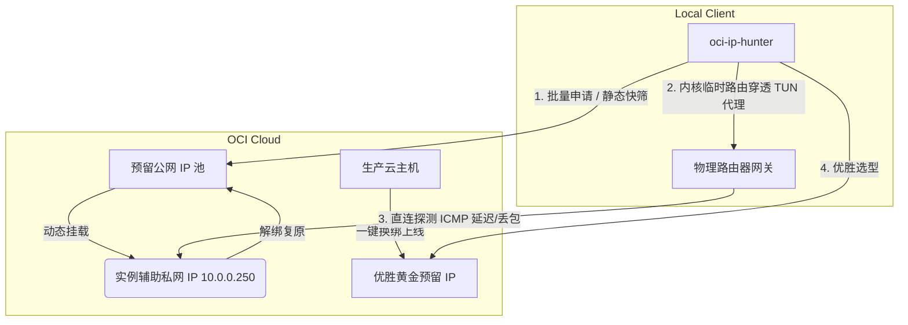

# oci-ip-hunter

[](https://www.python.org/downloads/)
[](https://github.com/oracle/oci-python-sdk)
[](LICENSE)
[](https://github.com/astral-sh/ruff)

An automated IP hunting, quality screening, unproxied physical latency benchmarking, and seamless production instance binding toolkit for **Oracle Cloud Infrastructure (OCI)**.

基于官方 **Oracle Cloud Infrastructure (OCI) 纯 Python SDK** 构建的 IP 资产全流程自动化治理工具箱。支持批量申请优选、多维度信誉与流媒体解锁快筛、绕过 TUN 代理的物理直连链路高精度测速，以及生产主机主公网 IP 一键无缝绑定。

---

## 🌟 Features

- **批量平滑猎取 (Hunt Mode)**: 循环批量申请预留公网 IP，结合三大黄金指标（欺诈分、IPPure 纯净度、流媒体与 AI 解锁）秒级快筛，达标保留并语义重命名，劣质秒级释放。内置防封动态随机休眠机制。
- **无代理物理链路真实测速 (Unproxied Benchmark)**: 注入临时物理网关直连路由，彻底穿透 Clash / Mihomo 等 TUN 虚拟网卡代理拦截；通过实例辅助私网 IP 动态 1:1 NAT 借壳挂载，测完即刻复原，不影响生产业务。
- **长效统计学压测**: 支持多轮（5~20 轮）物理 ICMP 采样，精准统计平均往返延迟 (RTT)、抖动 (Jitter) 与实际丢包率并生成综合排行榜。
- **生产主机一键换绑 (Bind Mode)**: 自动定位生产云主机主私网 IP（Primary Private IP），一键完成旧公网 IP 解绑/注销与优选黄金预留 IP 的绑定上线。
- **多维度风险与流媒体体检 (`ip_quality.py`)**: 聚合 Scamalytics、IPPure、IP2Location、邮件端口 (Port 25) 及 YouTube / Netflix / Disney+ / ChatGPT / Claude 解锁状态。
- **原生 OCI SDK 底座**: 纯 Python SDK 与 HTTPS REST API，零外部 OCI CLI 依赖。

---

## 🏗️ Architecture



---

## 📦 Requirements & Installation

- Python `>= 3.10`
- [uv](https://github.com/astral-sh/uv) (推荐) 或 `pip`

```bash
# 克隆仓库
git clone https://github.com/<YOUR_USERNAME>/oci-ip-hunter.git
cd oci-ip-hunter

# 使用 uv 同步依赖（推荐）
uv sync

# 或使用 pip
pip install -r requirements.txt
```

---

## ⚙️ Configuration

确保本地已配置 `~/.oci/config`（Windows 路径通常为 `C:\Users\<USER>\.oci\config`）：

```ini
[DEFAULT]
user=ocid1.user.oc1..aaaaaaaaxxxxxxxxxxxxxxxxxxxxxxxxxxxx
fingerprint=20:3b:97:13:55:1c:xx:xx:xx:xx:xx:xx:xx:xx:xx:xx
key_file=~/.oci/oci_api_key.pem
tenancy=ocid1.tenancy.oc1..aaaaaaaaxxxxxxxxxxxxxxxxxxxxxxxxxxxx
region=<YOUR_REGION>
```

> **Note**: 请将 `<YOUR_REGION>` 替换为您租户实际所在的区域标识代码（例如 `us-ashburn-1`、`ap-tokyo-1` 等）。

---

## 🚀 Quick Start

### 1. 挂桩直连链路测速 (`Latency`)

> **Note (Windows)**:
> 穿透 TUN 本地代理需要在物理网卡上临时下发直连路由，请在**以管理员身份运行**的终端中执行测速。

```bash
# 测试当前租户内所有已保留的公网 IP（默认 5 轮采样并输出排行榜）
uv run python tools/oracle_ip_loop.py --mode latency --all

# 高精度统计学压测（20 轮连续采样，评估长期稳定性）
uv run python tools/oracle_ip_loop.py --mode latency --all --rounds 20 --ping-count 2

# 指定单个预留公网 IP 测速
uv run python tools/oracle_ip_loop.py --mode latency --ip <PUBLIC_IP>
```

### 2. 批量申请与黄金 IP 猎取 (`Hunt`)

```bash
# 极速快筛模式（秒级质检，默认保留 5 个达标 IP）
uv run python tools/oracle_ip_loop.py --hunt --fast

# 自定义阈值猎取（欺诈分 < 5，IPPure ≤ 30%，流媒体解锁 ≥ 4 项）
uv run python tools/oracle_ip_loop.py --hunt --fast --max-scam 5 --max-ippure 30.0 --min-streaming 4
```

### 3. 生产主机主公网 IP 一键换绑 (`Bind`)

```bash
# 一键将优选出的预留 IP 绑定到生产主机的主私网 IP
uv run python tools/oracle_ip_loop.py --mode bind --ip <SELECTED_PUBLIC_IP>

# 交互式选择换绑
uv run python tools/oracle_ip_loop.py --mode bind
```

### 4. 纯静态单 IP / 列表风险体检 (`ip_quality.py`)

```bash
# 检测单个 IP 并输出仪表盘
uv run python tools/ip_quality.py 1.1.1.1

# 批量体检文件中的 IP 列表
uv run python tools/ip_quality.py --file tools/ips.example.txt
```

---

## 📖 CLI Reference

| 命令 / 模式 | 说明 | 关键参数 |
| :--- | :--- | :--- |
| `oracle_ip_loop.py --mode latency` | 挂测试桩无代理测速 | `--all`, `--ip <IP>`, `--rounds <N>`, `--ping-count <N>` |
| `oracle_ip_loop.py --hunt` | 批量优选摇号猎取黄金 IP | `--fast`, `--target <N>`, `--max-scam <N>`, `--max-ippure <F>`, `--naming-prefix <STR>` |
| `oracle_ip_loop.py --mode bind` | 生产云主机公网 IP 一键换绑 | `--ip <IP>`, `--instance-name <NAME>` |
| `oracle_ip_loop.py --mode pipeline` | 质量快筛 + 物理延迟双门禁联动 | `--fast`, `--max-rtt <MS>` |
| `ip_quality.py <IP>` | 静态信誉、欺诈分与流媒体解锁检测 | `--json`, `--file <PATH>` |
| `src/cli.py auth status` | 检查当前 OCI 凭据有效性 | `--online` |
| `src/cli.py compute list` | 列出租户内云主机实例状态 | `--compartment-id <OCID>` |
| `src/cli.py public-ip` | 查询当前租户预留公网 IP 清单 | `--type {available,assigned,all}` |

---

## 🔧 测试桩说明

为确保测速过程不中断生产实例现有网络，工具采用**借壳测试桩机制**：在目标实例网卡关联一个辅助私网 IP（默认 `10.0.0.250`）。测速时将待测公网 IP 临时绑定至该私网 IP，测完立即解绑。

首次使用时，请登录实例并确保操作系统已启用该辅助私网 IP：

```bash
# 查看主网卡接口名（通常为 enp0s6 或 ens3）
ip addr

# 添加辅助私网 IP（执行一次即可）
sudo ip addr add 10.0.0.250/24 dev enp0s6
```

---

## 📄 License

本项目基于 [MIT License](LICENSE) 开源。
